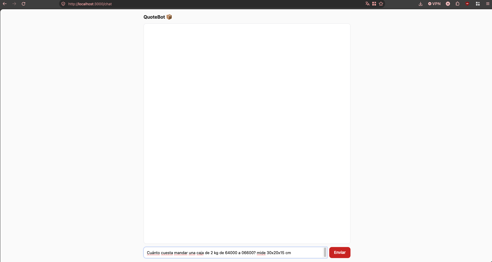
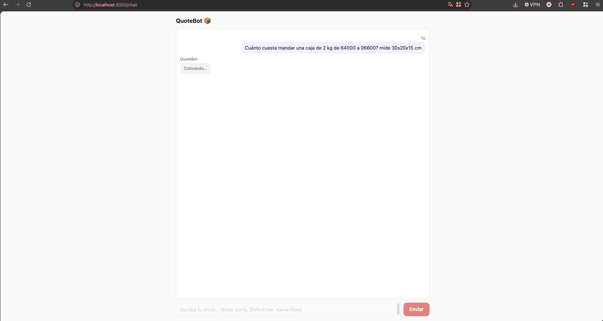
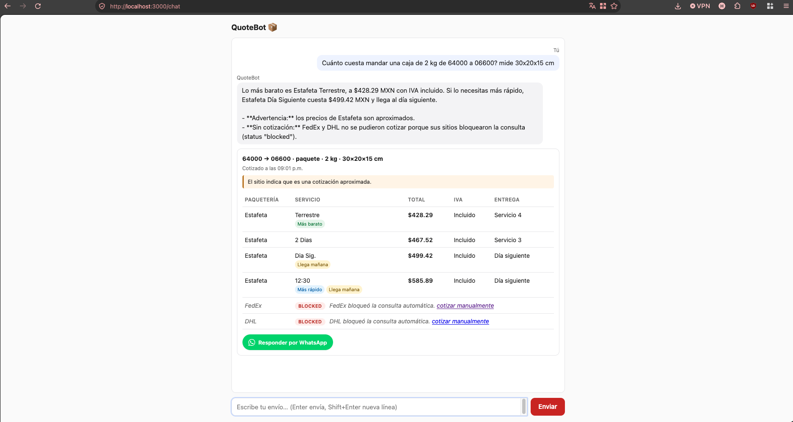
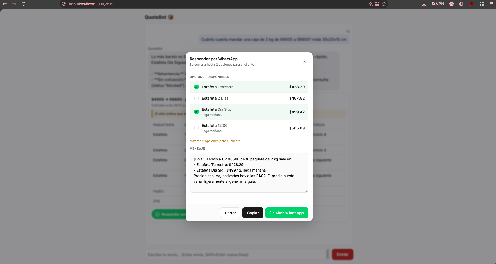

# NOTES: QuoteBot

**Idea central:** el LLM entiende y explica; el código valida, calcula, cotiza y ordena. Ningún precio llega a Mariana sin evidencia leída de un sitio.

## Qué encontré mal, en el orden en que lo arreglé
1. **El agente estaba diseñado para inventar precios.** El prompt decía "estima con tarifas de mercado", "nunca digas que no pudiste" y "dale un precio más bajo si se queja". En el "before", el caso 1 terminó con un rango inventado ($150–$350). Va primero porque es la única falla que le cuesta dinero a Mariana y la única regla dura del ejercicio.
2. **Las herramientas mentían.** `executeTool` devolvía `"ok"` ante cualquier error, incluso para `get_price`, que no existe. En el caso 1, los 9 selectores fallaron por timeout y el modelo le dijo a Mariana "llené el formulario y le di a Cotizar". Sin herramientas honestas, el agente no puede ser honesto.
3. **El modelo navegaba leyendo HTML crudo:** ~$3 y ~80 s por caso, sin conseguir un solo precio. La lógica de negocio vivía en un prompt contradictorio (IVA, divisor volumétrico, "solo Estafeta" vs. "compara 3").
4. **La UI:** "Cargando..." sin nada más, texto plano sin comparación y un "Error" genérico.

Antes de cambiar nada construí el eval, para medir el "before" con la misma regla que el "after".

## Qué cambié
- **Una sola herramienta, `quote_shipment`** (schema Zod). El modelo copia los datos con las unidades del usuario y nunca deduce un CP de una ciudad. Si falta algo, la herramienta devuelve `needs_input` y el bot pregunta todo en un mensaje.
- **La lógica de negocio va en código:** unidades, peso volumétrico (divisor 5000, verificado en Estafeta y FedEx), varios paquetes, ranking (barato, rápido, día siguiente) y los límites de cada sitio.
- **Adapters deterministas con Playwright para Estafeta, FedEx y DHL:**
  - Primero intento leer la respuesta de red; si no, el DOM.
  - Estados honestos: `ok`, `blocked`, `timeout`, `no_service`, `invalid_input` o `error`.
  - Siempre se guarda una captura, y el bloqueo se detecta también a mitad del flujo.
  - Estafeta: el formulario va directo al iframe del cotizador. FedEx: se captura el XHR de tarifas. DHL: se lee un GET público.
- **Guardrail:** cualquier monto en la respuesta tiene que existir en el resultado. Si no, se regenera o se responde con una plantilla.
- **Prompt nuevo de 7 reglas,** sin lógica de negocio. Sonnet en lugar de Opus, máximo 4 pasos.
- **UI:**
  - Tabla comparativa armada con código desde el resultado, no desde el texto del modelo. Incluye IVA, entrega, etiquetas (más barato, más rápido, llega mañana) y un link a la evidencia.
  - Cada paquetería que falló tiene su propia fila, con la razón en lenguaje claro.
  - La ruta `/evidence` está protegida contra path traversal, y el texto de terceros se pinta con `textContent`.

**Lo que no hice, a propósito:** nada que evada a Akamai (ni stealth ni proxies), caché o historial en SQLite, UPS y Redpack, cotizar el seguro (caso 8), progreso en vivo y llamar directo al GET de DHL.

## Trade-offs que elegí
- **FedEx muestra un 20% de "descuento por volumen" a visitantes sin sesión.** Reporto el precio regular como principal y el de descuento como nota. Cotizar de más es el error barato; Mariana ya pagó una diferencia por cotizar de menos.
- **DHL muestra precios sin IVA.** Los normalizo a "con IVA" sumando el IVA que el propio sitio reporta, nunca multiplicando por 1.16.
- **Caso 6 (sin medidas): lo corregí para cumplir la regla 4 del README ("never make up a price").** Cotizar con medidas inventadas daría un precio leído del sitio, pero de una caja que no es la del cliente: en la práctica, un precio inventado. Ahora el bot pide las medidas antes de cotizar. Como el `expect` del caso pide cotizar directamente, ajusté su chequeo en `checks.json` para reflejar esta decisión. El reporte honesto de paqueterías bloqueadas se mide en los casos 1, 3 y 7.
- **Scripts deterministas en lugar de dejar que el modelo navegue.** Pierdo flexibilidad si un sitio cambia, pero el fallo es visible (`error` con captura), no un precio inventado.

## Before / after
| | Casos | Pasan | Tiempo prom. | Costo prom. | Precios sin respaldo |
|---|---|---|---|---|---|
| Before (starter: Opus + prompt original) | 1, 6, 10 | 1/3 | 53.6 s | $1.70 | 1 |
| After (Sonnet + adapters) | 1, 3, 6, 7, 10 | 5/5 | 15.8 s | $0.010 | 0 |

- **El caso 1 lo dice todo.** Antes: 79 s y $3.02, sin precio. Ahora: precios reales de Estafeta con evidencia, y FedEx y DHL reportados como bloqueados por Akamai, en ~25 s y por $0.012 (~250× más barato).
- **Casos 3 (lb/in) y 7 (cuatro cajas)** pasan con la conversión y la suma hechas en código. Los casos que preguntan (6 y 10) responden en ~3 s sin tocar ningún sitio.
- **Cómo se mide:** chequeos deterministas sobre la traza estructurada, sin juez LLM (precio respaldado, preguntó lo que faltaba, estados por paquetería, unidades, ranking). El "before" se calificó con la versión anterior de los chequeos.
- **Traza de un bloqueo real:** `traces/2026-11-12-case-1.json` (FedEx y DHL `blocked`, con capturas en `evidence/2026-11-12/`). Con Playwright, Akamai bloqueó a FedEx y DHL; en un navegador normal no.

## Funcionalidad: "Responder por WhatsApp"
- **Para quién:** Mariana, cuando un cliente pregunta por WhatsApp cuánto cuesta el envío antes de comprar ("necesito una respuesta en un minuto").
- **Cómo funciona:** elige 1 o 2 opciones válidas (la mejor ya viene marcada) y obtiene un mensaje listo para copiar o abrir en `wa.me`. El mensaje lo arma una plantilla de código: precios con IVA, hora de la cotización y la nota de "aproximado" cuando el sitio lo dice. Tiene tests.
- **Lo que consideré y descarté:**
  - Presets de cajas y destinos: ahorran escribir, pero el cuello de botella es contestarle al cliente.
  - Filtro de "es regalo, tiene que llegar a tiempo": el ranking de día siguiente ya lo cubre en parte.
  - Historial de cotizaciones (fecha, ruta, precio, IVA y evidencia) para revisar después y dárselo a su contador, que le pregunta si los precios incluyen IVA: es el siguiente paso natural, encima de la caché.

## Uso de IA
- **Herramientas:** Claude como compañero de diseño (arquitectura, prompts, estas notas), Claude Code para implementar, y el navegador de Claude Desktop para explorar FedEx y DHL una sola vez cada uno.
- **Sugerencia rechazada: un juez LLM para el eval.** No es determinista, cuesta dinero y puede equivocarse. Con datos estructurados, los `expect` se verifican con código.
- **Error de la IA que atrapé:** la tabla de precios del eval tenía Opus a $15/$75 por millón de tokens; el precio real es $4/$20. Inflaba el costo del "before" 3.75×. Lo detecté comparando contra la página oficial de precios.
- **Error de la IA que atrapé:** en pedidos con varias cajas iguales, el precio se multiplicaba por la cantidad dos veces (en el adapter de Estafeta y otra vez en `aggregateForCarrier`). En el caso 7 (4 cajas de 10 kg), Terrestre salió en $12,461.92 en vez de $3,115.48 (4 × $778.87, el precio que muestra el sitio). El arreglo lo hice haciendo que los adapters regresan el precio por caja; solo `aggregateForCarrier` multiplica por la cantidad

## Qué haría después
1. Mostrar los resultados conforme llegan, sin esperar a las paqueterías bloqueadas. El caso 1 tarda ~25 s solo por eso.
2. Dejar fijo el mapeo de tipos de tarifa de FedEx (regular vs. descuento). Hoy se deduce como máximo/mínimo.
3. Cotizar el seguro opcional de Estafeta (caso 8) y quitar del mensaje de "falta información" la opción de dar ciudad en lugar de CP.
4. Caché de 24 h en SQLite: si se repite la misma paquetería, ruta (CP origen y destino), peso y medidas, se responde sin volver a visitar el sitio. Las fallas se guardan solo unos minutos y la UI muestra la antigüedad del precio. La misma tabla sirve de historial para su contador.
5. Correr el eval completo todos los días: detecta sitios que cambiaron (más fallas de red que caen al respaldo por DOM).
6. Costos para 200 envíos al mes: ~$0.01 de LLM por cotización. El reto real son los bloqueos, no el costo.

**Tiempo:** ~4 h 20 min. Me pasé unos 20 minutos, sobre todo explorando FedEx y DHL.

## Capturas

*Pantalla inicial. Mariana escribe el envío en lenguaje natural (caso 1: "Cuánto cuesta mandar una caja de 2 kg de 64000 a 06600? mide 30x20x15 cm").*

*Mientras se consultan los sitios en paralelo. El input y el botón se deshabilitan para evitar envíos duplicados.*

*Resultado del caso 1: recomendación corta del modelo, cabecera con ruta y peso cobrado, y tabla armada desde el resultado estructurado (precio, IVA, entrega y etiquetas "más barato" / "más rápido" / "llega mañana"). FedEx y DHL aparecen en su propia fila con el estado en lenguaje claro y un link para cotizar manualmente.*

*Modal "Responder por WhatsApp". Mariana elige hasta 2 opciones y copia o abre el mensaje listo en WhatsApp: precios con IVA, hora de la cotización y la nota de "aproximado" cuando el sitio lo marca.*
